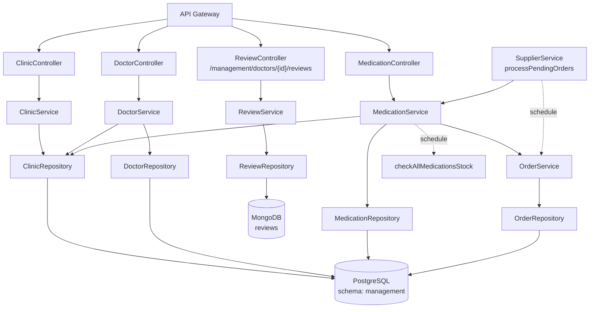
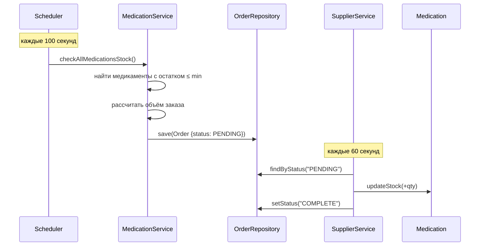

# 🏥 Management Service


> Административный микросервис: управление клиниками, врачами, лекарственными препаратами, заказами и отзывами. Автоматизирует складской учёт и имитирует взаимодействие с поставщиком.

---

## 📋 Назначение

**Management Service** — административное ядро платформы, обслуживающее внутренние бизнес-процессы ветеринарной клиники. Он отвечает за:

- ведение справочника **клиник** (мультиклиническая архитектура);
- управление штатом **врачей** с указанием специализации, графика работы и контактов;
- учёт **лекарственных препаратов** с контролем минимальных остатков;
- автоматическое **формирование заказов** на пополнение при снижении запасов;
- имитацию **взаимодействия с поставщиком** — фоновый процесс закрывает заказы и пополняет склад;
- сбор **отзывов** о врачах от владельцев питомцев.

Сервис использует **полиглотное хранение**: строго структурированные сущности (клиники, врачи, медикаменты, заказы) хранятся в PostgreSQL, а отзывы — в MongoDB, где гибкая схема и высокая скорость записи важнее транзакционной целостности.

---

## ✨ Ключевые возможности

### Мультиклиническая архитектура

Сущность `Clinic` — центральная точка привязки. Врачи и медикаменты привязаны к клинике через `ManyToOne`. Фильтрация по клинике реализована на уровне репозиториев:
- `GET /management/doctors/clinic/{clinicId}`
- `GET /management/medicines/clinic/{clinicId}`

### Управление врачами

CRUD-операции с валидацией на уровне сущности:
- **ФИО** с ограничениями длины;
- **специализация** (ENUM: терапевт, хирург, стоматолог, дерматолог, кардиолог, онколог, экзотические животные и др.);
- **номер лицензии** — паттерн `^[A-Za-z0-9-]{6,20}$`, уникален;
- **телефон и email** — уникальны, с валидацией формата;
- **график работы** — начало и конец рабочего дня (`LocalTime`), по умолчанию 10:00–18:00;
- **дата найма** — не может быть в будущем;
- **биография** — до 1000 символов.

Значения по умолчанию проставляются в `@PrePersist`, что избавляет сервисный слой от рутинных проверок.

### Учёт медикаментов

Модель `Medication` содержит как описательные, так и складские атрибуты:
- название, описание, производитель, номер партии;
- срок годности (не может быть в прошлом);
- количество на складе, минимальный уровень, объём повторного заказа;
- цена за единицу (`BigDecimal`, до 2 знаков после запятой);
- признак «только по рецепту».

**Два инварианта**, проверяемых через `@AssertTrue`:
1. Минимальный уровень запаса не может превышать текущий остаток.
2. Количество для повторного заказа должно быть строго больше минимального уровня.

Эти проверки дополняют стандартные `@PositiveOrZero`, `@Future` и `@DecimalMin`, предотвращая сохранение некорректных данных независимо от источника изменений.

### Автоматический контроль запасов

Планировщик `MedicationService.checkAllMedicationsStock` запускается с фиксированной задержкой **100 секунд** и выполняет:

1. Загрузку всех медикаментов.
2. Для каждого препарата с остатком ≤ минимального уровня — расчёт объёма заказа по формуле:
   ```
   orderQty = max(minStockLevel - quantityInStock, reorderQuantity)
   ```
3. Расчёт стоимости (`pricePerUnit × orderQty`).
4. Создание заказа со статусом `PENDING` через `OrderService`.

Таким образом, система **не требует ручного вмешательства** для инициации закупок — заявки формируются автоматически.

### Имитация поставщика

`SupplierService.processPendingOrders` запускается каждые **60 секунд** и обрабатывает заказы в статусе `PENDING`:

1. Увеличивает складской остаток медикамента на количество из заказа.
2. Переводит заказ в статус `COMPLETE`.

Это имитирует полный цикл закупки: заявка → поставка → пополнение склада → закрытие заказа. В случае сбоя на одном заказе цикл продолжается — исключение логируется, но не блокирует остальные.

### Сбор отзывов

Отзывы хранятся в отдельной коллекции MongoDB (`reviews`). Модель `Review` содержит:
- `doctorId` (UUID, сохранённый как строковое поле);
- имя автора;
- рейтинг от 1 до 5;
- текстовый комментарий (до 2000 символов);
- автоматически проставляемую дату создания (`@CreatedDate`).

При создании отзыва выполняется **двойная валидация**:
1. `doctorId` из пути запроса должен совпадать с `doctorId` в теле (защита от подмены).
2. Врач должен существовать в PostgreSQL — проверка через `DoctorService.existsById`.

Отзывы извлекаются с сортировкой по дате создания в обратном порядке (`findByDoctorIdOrderByCreatedAtDesc`), поэтому самые свежие мнения всегда наверху.

---

## 🛠 Технологический стек

| Компонент | Технология |
|---|---|
| Язык | Java 21 |
| Фреймворк | Spring Boot 3 |
| Web | Spring Web MVC |
| Persistence | Spring Data JPA (PostgreSQL), Spring Data MongoDB |
| Миграции | Liquibase |
| Маппинг | MapStruct |
| Валидация | Jakarta Bean Validation + `@AssertTrue` |
| Планировщик | Spring `@Scheduled` |
| Безопасность | Spring Security OAuth2 Resource Server, Keycloak |
| Логирование | SLF4J + Logback |
| Контейнеризация | Docker (multi-stage build) |

---

## 🏗 Архитектура сервиса



---

## 📁 Структура проекта

```
management-service/
├── src/main/java/ru/platform/management/
│   ├── ManagementApplication.java
│   ├── api/
│   │   ├── controller/
│   │   │   ├── ClinicController.java
│   │   │   ├── DoctorController.java
│   │   │   ├── MedicationController.java
│   │   │   └── ReviewController.java
│   │   ├── dto/
│   │   │   ├── ClinicRequestDto.java / ClinicResponseDto.java
│   │   │   ├── DoctorRequestDto.java / DoctorResponseDto.java
│   │   │   ├── MedicationRequestDto.java / MedicationResponseDto.java
│   │   │   ├── ReviewRequestDto.java
│   │   │   ├── SuccessResponseDto.java
│   │   │   └── ErrorResponseDto.java
│   │   └── mapper/
│   │       ├── ClinicMapper.java
│   │       ├── DoctorMapper.java
│   │       └── MedicationMapper.java
│   └── core/
│       ├── model/
│       │   ├── Specialization.java
│       │   └── entity/
│       │       ├── Clinic.java
│       │       ├── Doctor.java
│       │       ├── Medication.java
│       │       ├── Order.java
│       │       └── Review.java
│       ├── repository/
│       │   ├── jpa/
│       │   │   ├── ClinicRepository.java
│       │   │   ├── DoctorRepository.java
│       │   │   ├── MedicationRepository.java
│       │   │   └── OrderRepository.java
│       │   └── mongo/
│       │       └── ReviewRepository.java
│       └── service/
│           ├── ClinicService.java
│           ├── DoctorService.java
│           ├── MedicationService.java
│           ├── OrderService.java
│           ├── ReviewService.java
│           └── SupplierService.java
├── src/main/resources/
│   ├── application.properties
│   └── db/changelog/                       # Liquibase migrations
├── Dockerfile
├── build.gradle
└── README.md
```

---

## 📡 API

Все запросы идут через **API Gateway** (`/api/management/**`) с JWT в заголовке `Authorization: Bearer <token>`.

### Клиники — `/management/clinics`

| Метод | Путь | Описание |
|---|---|---|
| `POST` | `/management/clinics` | Создать клинику |
| `GET` | `/management/clinics` | Список всех клиник |
| `GET` | `/management/clinics/{id}` | Клиника по UUID |
| `PATCH` | `/management/clinics/{id}` | Частичное обновление |
| `DELETE` | `/management/clinics/{id}` | Удалить клинику |

### Врачи — `/management/doctors`

| Метод | Путь | Описание |
|---|---|---|
| `POST` | `/management/doctors` | Создать врача |
| `GET` | `/management/doctors` | Все врачи |
| `GET` | `/management/doctors/clinic/{clinicId}` | Врачи конкретной клиники |
| `GET` | `/management/doctors/{id}` | Врач по UUID |
| `PATCH` | `/management/doctors/{id}` | Частичное обновление |
| `DELETE` | `/management/doctors/{id}` | Удалить врача |

### Медикаменты — `/management/medicines`

| Метод | Путь | Описание |
|---|---|---|
| `POST` | `/management/medicines` | Добавить медикамент |
| `GET` | `/management/medicines` | Все медикаменты |
| `GET` | `/management/medicines/clinic/{clinicId}` | Медикаменты клиники |
| `GET` | `/management/medicines/{id}` | Медикамент по UUID |
| `PATCH` | `/management/medicines/{id}` | Частичное обновление |
| `DELETE` | `/management/medicines/{id}` | Удалить медикамент |

### Отзывы — `/management/doctors/{doctorId}/reviews`

| Метод | Путь | Описание |
|---|---|---|
| `GET` | `/management/doctors/{doctorId}/reviews` | Отзывы о враче |
| `POST` | `/management/doctors/{doctorId}/reviews` | Добавить отзыв |

### Пример: создание врача

```http
POST /management/doctors
Authorization: Bearer <JWT>
Content-Type: application/json

{
  "id": "a1b2c3d4-...",
  "clinicId": "c1c2c3d4-...",
  "firstName": "Иван",
  "lastName": "Иванов",
  "middleName": "Иванович",
  "specialization": "SURGEON",
  "licenseNumber": "LIC-123456",
  "phoneNumber": "+79991234567",
  "email": "ivanov@clinic.ru",
  "hireDate": "2020-03-15",
  "startWorkingDay": "09:00",
  "endWorkingDay": "18:00",
  "bio": "Опытный хирург с 10-летним стажем"
}
```

### Пример: создание медикамента

```http
POST /management/medicines
Authorization: Bearer <JWT>
Content-Type: application/json

{
  "clinicId": "c1c2c3d4-...",
  "name": "Амоксициллин",
  "description": "Антибиотик широкого спектра действия",
  "manufacturer": "Sandoz",
  "batchNumber": "AMX-2024-01",
  "expiryDate": "2027-01-01",
  "quantityInStock": 50,
  "minStockLevel": 10,
  "reorderQuantity": 100,
  "pricePerUnit": 250.00,
  "isPrescriptionOnly": true
}
```

### Пример: создание отзыва

```http
POST /management/doctors/a1b2c3d4-.../reviews
Authorization: Bearer <JWT>
Content-Type: application/json

{
  "doctorId": "a1b2c3d4-...",
  "authorName": "Пётр Петров",
  "rating": 5,
  "comment": "Очень внимательный врач, помог нашему коту!"
}
```

### Обработка ошибок

| Исключение | HTTP-статус | Когда возникает |
|---|---|---|
| `EntityNotFoundException` | 404 | Клиника, врач, медикамент или заказ не найдены |
| `IllegalArgumentException` | 400 | Несовпадение `doctorId` в пути и теле, отсутствие врача |
| `MethodArgumentNotValidException` | 400 | Нарушены инварианты валидации |
| `Exception` | 500 | Общая ошибка |

---

## 🗄 Модель данных

### PostgreSQL (схема `management`)

#### Таблица `clinics`

| Поле | Тип | Описание |
|---|---|---|
| `id` | UUID | PK, генерируется автоматически |
| `name` | String | Название клиники (обязательно) |
| `address` | String | Адрес |
| `phone` | String | Телефон |

#### Таблица `doctors`

| Поле | Тип | Описание |
|---|---|---|
| `id` | UUID | PK (задаётся клиентом) |
| `clinic_id` | UUID | FK → `clinics.id` |
| `first_name`, `last_name`, `middle_name` | String | ФИО |
| `specialization` | Enum | Специализация (`SURGEON`, `DENTIST`, ...) |
| `license_number` | String | **Уникален**, паттерн |
| `phone_number` | String | **Уникален**, паттерн |
| `email` | String | **Уникален**, email |
| `hire_date` | Date | Дата найма (`@PastOrPresent`) |
| `start_working_day`, `end_working_day` | Time | График |
| `bio` | String | До 1000 символов |

#### Таблица `medications`

| Поле | Тип | Описание |
|---|---|---|
| `id` | UUID | PK, автогенерация |
| `clinic_id` | UUID | FK → `clinics.id` |
| `name` | String | Название |
| `description` | String | До 500 символов |
| `manufacturer` | String | Производитель |
| `batch_number` | String | Паттерн |
| `expiry_date` | Date | `@Future` |
| `quantity_in_stock` | Integer | `@PositiveOrZero` |
| `min_stock_level` | Integer | `@PositiveOrZero` |
| `reorder_quantity` | Integer | `@Positive` |
| `price_per_unit` | BigDecimal | > 0, до 2 знаков |
| `is_prescription_only` | Boolean | Рецептурный |

#### Таблица `orders`

| Поле | Тип | Описание |
|---|---|---|
| `id` | UUID | PK, автогенерация |
| `medication_id` | UUID | FK → `medications.id` |
| `order_date` | DateTime | Дата создания |
| `quantity` | Integer | > 0 |
| `total_amount` | BigDecimal | > 0 |
| `status` | String | `PENDING` / `COMPLETE` |
| `is_paid` | Boolean | По умолчанию `false` |
| `notes` | String | До 1000 символов |

### MongoDB (коллекция `reviews`)

| Поле | Тип | Описание |
|---|---|---|
| `id` | String | PK (ObjectId как строка) |
| `doctorId` | UUID (хранится как String) | ID врача |
| `authorName` | String | Имя автора |
| `rating` | Integer | 1–5 |
| `comment` | String | До 2000 символов |
| `createdAt` | LocalDateTime | `@CreatedDate` |

---

## 🔄 Ключевые сценарии

### Автоматический заказ медикамента



### Полный цикл пополнения склада

1. **Планировщик** (`checkAllMedicationsStock`) находит препарат с остатком ниже минимума.
2. Формирует заказ: `max(дефицит, reorderQuantity)`, считает стоимость.
3. Сохраняет заказ со статусом `PENDING`.
4. **Планировщик поставщика** (`processPendingOrders`) через некоторое время:
   - увеличивает складской остаток на количество из заказа;
   - переводит заказ в статус `COMPLETE`.
5. Следующая итерация проверки склада уже не находит дефицита.

### Работа с отзывами

1. Клиент вызывает `POST /management/doctors/{doctorId}/reviews`.
2. `ReviewService` проверяет совпадение `doctorId` в пути и теле.
3. Проверяет существование врача через `DoctorService.existsById`.
4. Создаёт и сохраняет документ в MongoDB.
5. `@CreatedDate` автоматически проставляет дату.

При чтении отзывы возвращаются отсортированными по дате (свежие — первыми).

---

## ⚙️ Конфигурация

### Переменные окружения

| Переменная | Назначение | Значение по умолчанию |
|---|---|---|
| `POSTGRES_HOST` / `POSTGRES_PORT` | PostgreSQL | `localhost` / `5432` |
| `POSTGRES_DB` | Имя БД | `vet_clinic` |
| `POSTGRES_USER` / `POSTGRES_PASSWORD` | Учётные данные | — |
| `MONGO_HOST` / `MONGO_PORT` | MongoDB | `localhost` / `27017` |
| `KEYCLOAK_ISSUER_URI` | Issuer URI Keycloak | `http://localhost:8080/realms/clinic-realm` |

### `application.properties` (фрагмент)

```properties
server.port=8082
spring.application.name=management

spring.datasource.url=jdbc:postgresql://${POSTGRES_HOST}:${POSTGRES_PORT}/${POSTGRES_DB}
spring.datasource.username=${POSTGRES_USER}
spring.datasource.password=${POSTGRES_PASSWORD}
spring.jpa.hibernate.ddl-auto=validate
spring.jpa.properties.hibernate.default_schema=management

spring.liquibase.change-log=classpath:db/changelog/db.changelog-master.xml

spring.data.mongodb.uri=mongodb://${MONGO_HOST}:${MONGO_PORT}/vet-clinic

spring.security.oauth2.resourceserver.jwt.issuer-uri=${KEYCLOAK_ISSUER_URI}
```

---

## 🚀 Запуск

### Локально (Docker Compose)

```bash
docker compose up -d management-service postgres mongo keycloak
```

### Запуск только сервиса

```bash
cd services/management
./gradlew bootRun
```

### Сборка образа

```bash
docker build -t management-service:latest .
```

### Проверка

```bash
curl http://localhost:8082/actuator/health

curl -H "Authorization: Bearer $TOKEN" \
     http://localhost:8888/api/management/doctors
```

---

## 🔗 Связанные сервисы

| Сервис | Как использует Management Service |
|---|---|
| **Appointment Service** | Получает данные врача и его график для подбора слота |
| **VK Bot Service** | Получает ФИО врача для отображения в записях |
| **API Gateway** | Проксирует запросы, валидирует JWT |
| **Keycloak** | Выдаёт токены для межсервисных вызовов |

---
